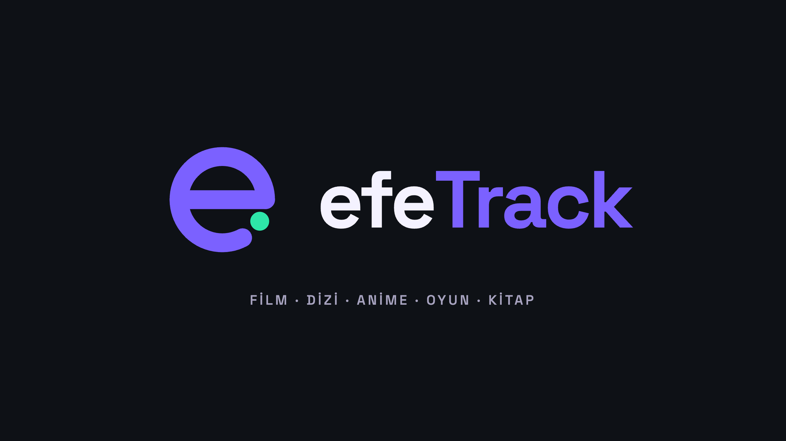
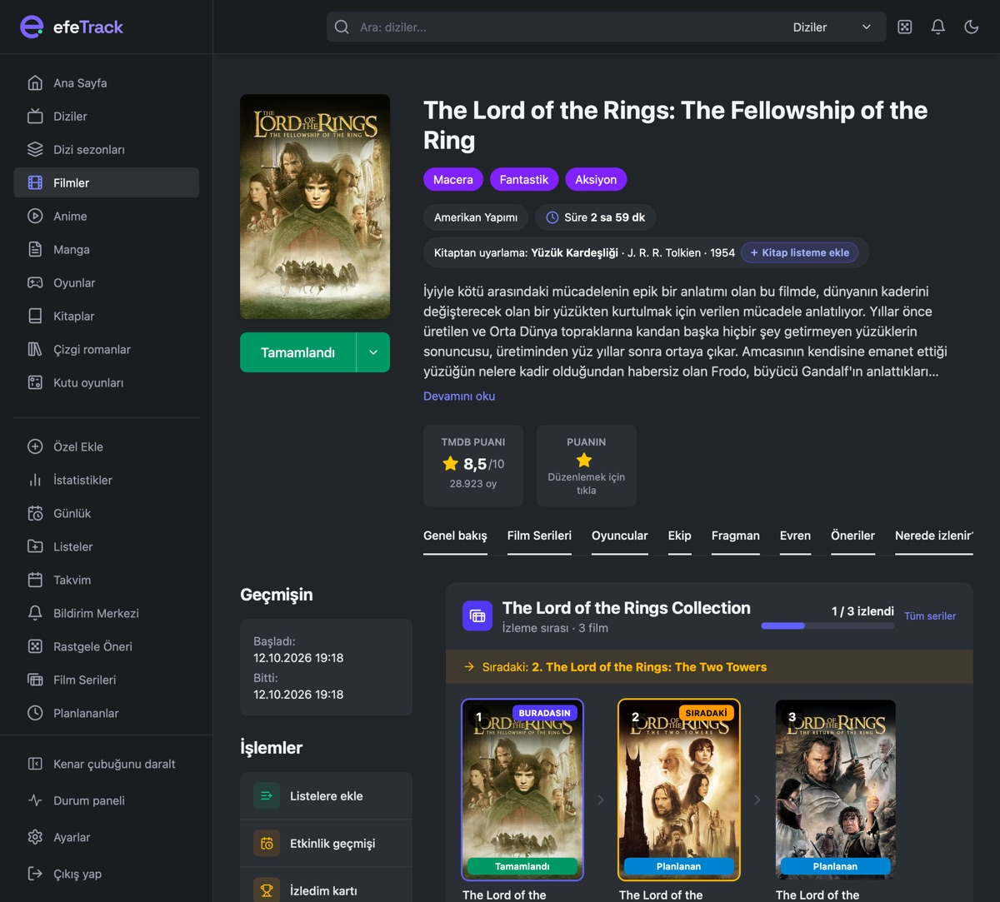
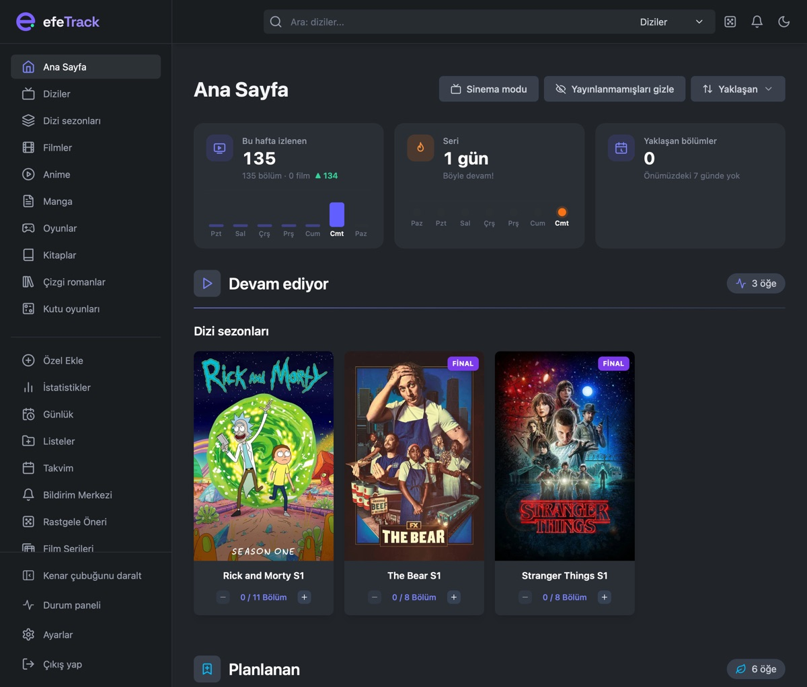
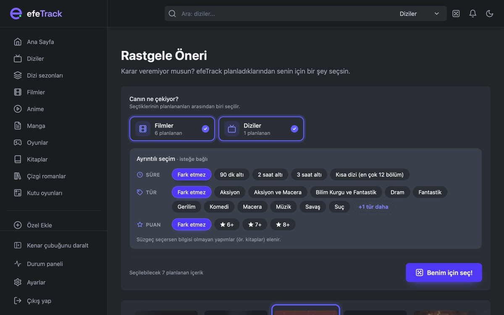
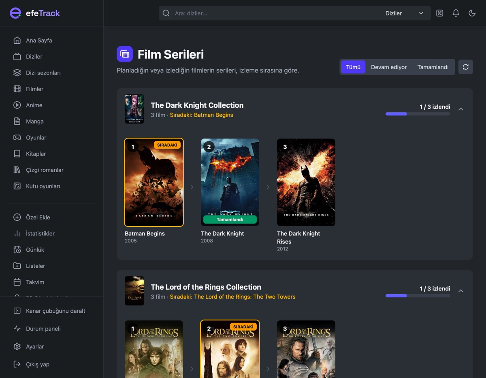
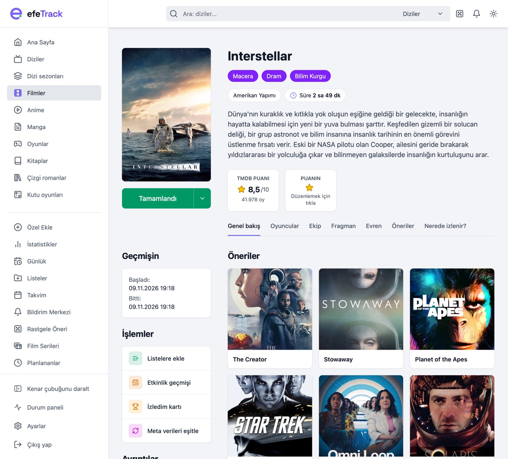

# efeTrack



**efeTrack**, açık kaynaklı [Yamtrack](https://github.com/FuzzyGrim/Yamtrack) medya takipçisinin
Türkçe odaklı, geliştirilmiş bir sürümüdür. Film, dizi, anime, manga, oyun, kitap, çizgi roman ve
kutu oyunlarını kendi sunucunda takip edersin. Yamtrack'in tüm özellikleri korunur; üstüne aşağıdaki
yenilikler eklenmiştir.



## Neden yaptım

Yamtrack yalnızca İngilizceydi. Bir filmin Türkiye'de hangi platformda olduğunu ya da takip ettiğim
dizilerin yeni bölümlerini öğrenmek için ayrı sitelerde arama yapmam gerekiyordu. Veriler de tek bir
sunucuda duruyordu ve düzenli bir yedeği yoktu. efeTrack bu sorunları kendi günlük kullanımım için çözüyor.

## ✨ efeTrack'te yeni olanlar

| Özellik | Açıklama |
| --- | --- |
| 🇹🇷 **Tam Türkçe arayüz** | Menüler, ayarlar, formlar, hata mesajları, bildirimler, takvim, istatistikler, içe aktarma ekranları… her şey Türkçe. Varsayılan dil Türkçedir, giriş/kayıt sayfaları da Türkçe açılır. Türler (Bilim Kurgu, Dram…), yayın durumları, ülke ve dil adları, süreler (2 sa 47 dk), anime sezonları (Sonbahar 2024) ve yayın günleri de Türkçeye çevrilir. TMDB'de Türkçe özeti olan film ve dizilerin açıklaması Türkçe gösterilir. **Dizi, film, kitap, çizgi roman ve anime adları çevrilmez**; Türk yapımları orijinal adıyla görünür. |
| 🌗 **Karanlık / aydınlık / sistem teması** | Üst çubuktaki düğmeyle tek tıkla değiştir, ya da *Ayarlar → Tercihler* bölümünden seç. *Sistem* seçeneği işletim sisteminin temasını izler. |
| 🔔 **Bildirim merkezi** | Takip ettiğin dizilerin, animelerin ve filmlerin yeni bölümlerini tek yerde görürsün: *Bugün*, *Yeni çıkanlar* (son 7 gün) ve *Yakında* (7/14/30/60 gün). Üst çubukta okunmamış sayısını gösteren zil ve açılır menü, ana sayfada "Yaklaşanlar" şeridi, isteğe bağlı tarayıcı bildirimleri. Bir bölüm yaklaşırken bir kez, yayınlandığında bir kez daha bildirilir. |
| 🎲 **Rastgele öneri** | "Planlanan" listendeki içeriklerden şans makinesi animasyonu ve seslerle rastgele bir öneri. Medya türüne veya özel listelerinden birine göre filtrelenebilir; "Başka bir tane seç" ile aynı öneri tekrar gelmez. |
| 🎞️ **Film serileri ve izleme sırası** | Bir film bir seriye (üçleme, devam filmleri…) aitse detay sayfasında serinin tamamı çıkış sırasıyla, senin durumunla (Tamamlandı / Planlanan…) ve "Sıradaki" film işaretiyle gösterilir. *Film Serileri* sayfası, kütüphanendeki tüm serileri ilerleme çubuklarıyla listeler. |
| 📺 **Türkiye'de nerede izlenir?** | Film, dizi ve sezon sayfalarında Türkiye'deki platformlar *Abonelikle / Ücretsiz / Reklamlı / Kirala / Satın al* olarak gruplanır (Netflix, Prime Video, Disney+, HBO Max, BluTV, TOD, Exxen, Gain, Tabii, puhutv, TV+, MUBI, Apple TV, Google Play…). Platforma tıklayınca doğrudan o platforma (mümkünse aramaya) gidersin; hiçbir yerde yoksa JustWatch Türkiye araması önerilir. |
| 🔊 **Ses efektleri** | Takibe eklerken, bir şeyi tamamladığında (küçük bir fanfar), silerken, rastgele seçimde, tema değiştirirken ve yeni bildirim geldiğinde kısa sesler. Dosya indirmez, tarayıcıda sentezlenir. *Tercihler*'den kapatılabilir, ses seviyesi ayarlanabilir. |
| 🤖 **Telegram botu** | Türkçe komutlarla bugün, yarın ve bu hafta yayınlananlar, “sıradaki bölüm ne zaman?”, sıradaki bölümü izlendi işaretleme, izleme geçmişi, nerede izlenir, aylık afiş takvimi, haftalık istatistik ve grafikler, aylık PDF rapor, rastgele ve kısa film önerisi, sunucu durumu. Uzun sorgulama (long polling) ile çalışır, dışarıya açık bir adres gerekmez. |
| ✨ **Ekstralar** | Yeni logo ve simgeler, Türkçe tarih biçimleri (18.01.2026 veya 18 Ocak 2026), İstanbul saat dilimi, Türkiye varsayılan yayın bölgesi, ana sayfada yaklaşan bölümler, TMDB'ye ulaşılamadığında bile açılan Tercihler sayfası. |

<p>
  
  
  
  
</p>

## 📈 Sunucuda

efeTrack kendi sunucumda Docker ile çalışıyor ve düzenli olarak kendim kullanıyorum. Uygulamanın çevresinde:

- **Gecelik yedek:** Her gece 03:30'da sunucudaki küçük bir yedek konteyneri veritabanını yedekler; günlük, haftalık ve aylık yedekler saklanır.
- **Aylık yedek provası** ([`deploy/bekci/yedek_prova.py`](deploy/bekci/yedek_prova.py)): Son yedek internete kapalı, geçici bir konteynerde açılır, veritabanı güncellenir, okunabiliyor mu bakılır ve sonuç bildirilir.
- **Bekçi** ([`deploy/bekci/bekci.py`](deploy/bekci/bekci.py)): Beş dakikada bir konteynerleri, siteyi, yedeklerin tazeliğini, diski ve belleği kontrol eder; bir sorun varsa Telegram'dan mesaj atar.

## 🚀 Kurulum (Docker)

Gerekenler: [Docker](https://docs.docker.com/get-docker/) ve Docker Compose.

1. Bu klasörü sunucuna/bilgisayarına kopyala ve içine gir.
2. `docker-compose.yml` dosyasındaki `SECRET` değerini uzun, rastgele bir metinle değiştir.
3. Çalıştır:

   ```bash
   docker compose up -d --build
   ```

4. Tarayıcıda `http://localhost:8000` adresini aç, **Kaydol** ile hesabını oluştur.

İlk derleme birkaç dakika sürebilir (Python paketleri indirilir, Türkçe çeviriler derlenir).
PostgreSQL kullanmak istersen `docker compose -f deploy/docker/docker-compose.postgres.yml --project-directory . up -d --build`.

### Yamtrack'ten geçiş

efeTrack, Yamtrack veritabanıyla uyumludur. Mevcut Yamtrack kurulumunun `db` klasörünü (SQLite) veya
PostgreSQL veritabanını aynı şekilde bağlaman yeterli; açılışta veritabanı otomatik güncellenir ve
varsayılan ayarlardaki kullanıcılar Türkçe arayüze, Türkiye yayın bölgesine ve Türkçe tarih biçimine
geçirilir. Önce mutlaka yedek al. Yamtrack'in CSV yedekleri de *Ayarlar → Veri içe aktar* bölümünden
içe aktarılabilir.

## ⚙️ Ayarlar (ortam değişkenleri)

Yamtrack'in tüm değişkenleri geçerlidir. Tam liste, sosyal hesapla giriş, içe aktarma kaynakları ve yönetici paneli için [Yamtrack belgelerine](https://fuzzygrim.github.io/Yamtrack/) bak. efeTrack'e özel olanlar:

| Değişken | Varsayılan | Açıklama |
| --- | --- | --- |
| `LANGUAGE_CODE` | `tr` | Yeni kullanıcıların ve giriş sayfasının dili (`tr`, `en`, `it-it`). |
| `LANGUAGE_FROM_BROWSER` | `False` | `True` yapılırsa giriş yapmamış ziyaretçiler tarayıcılarının dilini görür. |
| `TZ` | `Europe/Istanbul` | Saat dilimi. |
| `DEFAULT_WATCH_PROVIDER_REGION` | `TR` | "Nerede izlenir?" bölgesi. Kullanıcı ayarlardan değiştirebilir. `UNSET` her kullanıcıya seçtirir. |
| `TMDB_CONTENT_LANGUAGE` | `tr` | TMDB'de varsa özetlerin gösterileceği dil. Boş bırakılırsa İngilizce özet kullanılır. |
| `DEFAULT_DATE_FORMAT` | `d.m.Y` | Yeni kullanıcıların tarih biçimi. |
| `EFE_SITE_DOMAIN` | *(boş)* | Paylaşım kartlarının ve aylık raporların altına yazılan adres (ör. `track.example.com`). Boşsa hiçbir şey yazılmaz. |

## ℹ️ Bilinmesi gerekenler

- İçerik açıklamaları sağlayıcılardan gelir. TMDB'de Türkçe özeti olan film ve diziler Türkçe görünür;
  MyAnimeList, AniList, IGDB, OpenLibrary gibi kaynaklar Türkçe açıklama sunmadığı için bu açıklamalar
  İngilizce kalabilir. Bu kaynakların türleri, durumları ve biçimleri yine de Türkçeye çevrilir.
- "Nerede izlenir?" verisi TMDB üzerinden JustWatch'tan gelir; Türkiye'deki bazı yerli platformlar bu
  veride her zaman yer almayabilir.
- Tarayıcı bildirimleri, efeTrack bir sekmede açıkken çalışır. Uygulama kapalıyken bildirim almak için
  *Ayarlar → Bildirimler* bölümünden Apprise (Telegram, Discord, e-posta…) kurabilirsin.
- Tema ve ses tercihleri hesabına kaydedilir; giriş yapmadan önceki sayfalar son seçilen temayı hatırlar.

## 🎨 Marka ve simgeler

Logo, uygulama simgeleri ve favicon'lar `src/static/img/brand/` ile `src/static/favicon/` altında bulunur:

- `efetrack-logo-dark.svg` / `efetrack-logo-light.svg`: koyu ve açık zemin için yatay logo.
  Kenar çubuğunda ve giriş sayfasında temaya göre otomatik değişir.
- `efetrack-mark*.svg`: yalnızca "e" işareti.
- `efetrack-icon-dark.svg` (varsayılan), `efetrack-icon-purple.svg`, `efetrack-icon-light.svg`: uygulama simgeleri.
- Favicon (SVG, 16/32 px, `.ico`), Apple dokunmatik simgesi ve Android/PWA simgeleri (maskable dahil)
  koyu varsayılan simgeden üretilmiştir.

Renkler: mor `#7B61FF`, koyu `#0E1116`, yeşil nokta `#2EE6A8` (koyu zemin) / `#12A57A` (açık zemin).

## 🛠️ Geliştirme

Gerekenler: [uv](https://docs.astral.sh/uv/getting-started/installation/), [Tailwind CSS CLI](https://tailwindcss.com/docs/installation/tailwind-cli)
(`npm install -g tailwindcss @tailwindcss/cli`), Docker (Redis için) ve [GNU gettext](https://www.gnu.org/software/gettext/)
(macOS'ta `brew install gettext`, Debian/Ubuntu'da `sudo apt install gettext`).

```bash
git clone https://github.com/yefetfkc/efetrack.git
cd efetrack
docker run -d --name redis -p 6379:6379 --restart unless-stopped redis:8-alpine
uv sync
```

Depo kökünde bir `.env` dosyası oluştur (anahtarları kendi hesaplarından al):

```bash
TMDB_API=API_ANAHTARI
MAL_API=API_ANAHTARI
IGDB_ID=IGDB_ID
IGDB_SECRET=IGDB_SECRET
STEAM_API_KEY=STEAM_ANAHTARI
BGG_API_TOKEN=BGG_ANAHTARI
SECRET=uzun-rastgele-bir-metin
DEBUG=True
```

Veritabanını hazırla ve çevirileri derle (`.mo` dosyaları depoda yok):

```bash
cd src
uv run manage.py migrate
uv run manage.py compilemessages
```

Ardından üç ayrı terminalde web sunucusunu, arka plan işçisini ve Tailwind izleyicisini çalıştır,
sonra `http://localhost:8000` adresini aç:

```bash
cd src && uv run manage.py runserver
cd src && uv run celery -A config worker --beat --scheduler django --loglevel DEBUG
cd src && tailwindcss -i ./static/css/input.css -o ./static/css/main.css --watch
```

Testler (bazı testler çevrilmiş metni kontrol ettiği için önce çevirileri derle):

```bash
uv run playwright install          # entegrasyon testleri için tarayıcılar
cd src
uv run manage.py test --parallel   # tüm testler
uv run manage.py test efe          # yalnız efeTrack testleri
```

efeTrack'e özel kodun çoğu `src/efe/` uygulamasındadır. Türkçe çeviriler `src/locale/tr/LC_MESSAGES/`
klasöründe, tema renkleri `src/static/css/input.css` dosyasındaki `--ef-*` değişkenlerindedir.

**Teknolojiler:** Python · Django · Celery · Redis · SQLite / PostgreSQL · Tailwind CSS · Docker

## 📄 Lisans ve teşekkür

efeTrack, [FuzzyGrim/Yamtrack](https://github.com/FuzzyGrim/Yamtrack) projesinin bir türevidir ve aynı
**GNU AGPL-3.0** lisansıyla dağıtılır (bkz. [LICENSE](LICENSE)). Özgün proje ve belgeleri: [GitHub](https://github.com/FuzzyGrim/Yamtrack).
Film/dizi verileri [TMDB](https://www.themoviedb.org/), yayın platformu verileri [JustWatch](https://www.justwatch.com/)
tarafından sağlanır.
Bu ürün TMDB API'sini kullanır ancak TMDB tarafından onaylanmamış ya da sertifikalandırılmamıştır.
